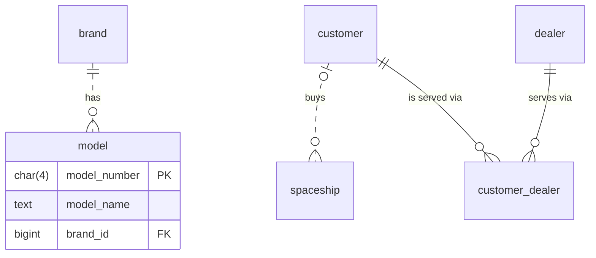

# Modelagem de banco relacional → Supabase

Método baseado em *Grokking Relational Database Design* (Hao & Tsikerdekis, 2025), caps. 3–8. Pontos marcados com **[Supabase]** não vêm do livro: são adaptações para Postgres/Supabase.

Entregáveis, nesta ordem:
1. `design.md`: a especificação em texto, que é a fonte da verdade
2. `erd.md`: diagrama E-R em Mermaid com todos os conectores crow's foot explícitos (penúltimo passo)
3. `CLAUDE_CODE_BRIEF.md`: instrução para o Claude Code criar o banco no Supabase (entregável final)

## Regras de trabalho (lições do cap. 8)

1. **Uma fase por vez, com checkpoint.** Ao fim de cada fase, mostre o resultado no formato definido, liste as suposições e pendências e espere o usuário aprovar ou corrigir. Não pule para o SQL.
2. **O design vive em texto.** Ao fim de cada fase, atualize o `design.md` e trabalhe sempre a partir dele, não da memória da conversa.
3. **Não invente regra de negócio.** Quando os requisitos não sustentam uma decisão (escolha da PK, cardinalidade mínima, se um campo é obrigatório, o que acontece ao apagar), pergunte. Se não houver resposta, registre a suposição em `## Pendências`.
4. **Siga os formatos de saída abaixo.** Eles existem para que cada fase alimente a próxima.
5. **Autocheque os erros que a IA cometeu no livro** antes de mostrar cada fase:
   - PK escolhida por suposição: email ou telefone como PK quando os requisitos permitem alterá-los, ou nome quando ele pode se repetir. O livro aceita email como PK quando a regra de negócio garante que ele não muda (cap. 3); o erro da IA no cap. 8 foi assumir essa estabilidade sem checar os requisitos
   - relação ausente ou mal interpretada quando o requisito está espalhado em várias frases
   - cardinalidade mínima errada (o erro mais comum)
   - `NOT NULL` faltando, ou atributo que precisa de mais de uma restrição (ex.: `NOT NULL` + `UNIQUE`)
   - tipo de outro SGBD (ex.: `YEAR` do MySQL não existe no Postgres)
   - campos compostos sem estrutura (endereço numa coluna só, telefone com código do país embutido)

## Fase 0: escopo e insumos

Pergunte o que ainda não estiver claro, em no máximo uma rodada de perguntas:
- Para que serve o banco e que aplicação vai usá-lo (app web, automação n8n/Make, painel interno)?
- Quem lê e quem escreve: usuários finais logados, equipe interna, service role?
- Quais insumos existem: transcrições de entrevista, planilhas, exports ou schema de outra base, prints de sistemas?
- Os nomes de tabela e coluna serão em inglês ou em português? Use snake_case em qualquer caso.

Leia todos os arquivos enviados. Se houver uma base existente, extraia as tabelas, colunas e relações dela como ponto de partida, não como verdade.

## Fase 1: requisitos

- Extraia os substantivos. Use o teste do "tem/possui": em "um cliente **tem** um telefone", o possuído (telefone) é característica e o possuidor (cliente) é sujeito.
- Para cada par de sujeitos, levante as perguntas de relação: "Um X pode ter vários Y? Um Y pode pertencer a vários X? Um X pode existir sem Y?"
- Peça dados de exemplo reais, pois eles revelam tamanhos, formatos e casos-limite.

**Saída:** uma lista numerada de requisitos sintetizados em frases curtas, no estilo do livro:
```
R1. Uma marca tem vários modelos; um modelo pertence a uma marca.
R2. Um cliente pode atualizar email e telefone.
R3. Clientes podem estar em qualquer país.
```
Inclua também `## Perguntas abertas` → checkpoint.

## Fase 2: entidades, atributos e tipos

- Os nomes de entidade ficam no singular e em snake_case. A PK surrogate segue o padrão `<entidade>_id`, e a mesma convenção vale em todas as tabelas.
- Os atributos são atômicos (1NF): nada de listas numa coluna e nada de campos compostos sem estrutura. Endereço vira colunas próprias; telefone fica separado em `country_code` + `phone_number`.
- Um grupo de atributos que se repete em várias entidades (ex.: endereço em `customer` e `dealer`) vira entidade própria.
- O tipo é definido junto com o atributo, porque decisões de tipo mudam a estrutura.

**[Supabase] Tipos Postgres:**
| Necessidade | Tipo |
|---|---|
| PK surrogate | `bigint generated always as identity`; use `uuid default gen_random_uuid()` se o id for exposto publicamente ou gerado no cliente |
| texto livre | `text` (com `check (char_length(x) <= n)` se houver limite real) |
| código de tamanho fixo (país ISO, UF) | `char(n)` ou `text` com check |
| dinheiro | `numeric(p,s)`, nunca `float` |
| ano | `smallint` com check |
| data/hora | `timestamptz`; `date` para data pura |
| categoria cujos valores mudam | tabela de lookup (preferível a enum) |
| JSON | `jsonb`, só para dados realmente sem estrutura fixa |
| usuário logado | FK para `auth.users(id)` (uuid). Nunca armazene senha. |

**Saída por entidade:**
```
Entidade: customer
Atributos:
- customer_id — bigint identity
- name — text
- email_address — text
- country_code — char(2)  → FK country
- phone_number — varchar(15)
PK: customer_id
Notas: email_address UNIQUE; (country_code, phone_number) UNIQUE
```

## Fase 3: chaves primárias

Para cada entidade, justifique a PK em uma linha:
- Uma chave natural só serve como PK se for **única e estável** (não muda nunca).
- Antes de aceitar email, telefone, documento ou nome como PK, confirme nos requisitos se o valor pode mudar ou se repetir. Se os requisitos não disserem, pergunte em vez de supor, e registre a resposta como requisito (ex.: "R12. O cliente não pode alterar o email.").
- Se não houver uma assim, use uma surrogate e mantenha a candidata natural com `UNIQUE`. Isso evita duplicidade, coisa que a surrogate sozinha não impede.
- Tabelas de junção usam PK composta pelas FKs.

As Fases 2 e 3 podem ir num único checkpoint.

## Fase 4: frases de relação e diagrama simples

Para **cada par** de entidades relacionadas, escreva **duas frases direcionais** com mínimo e máximo explícitos:
```
customer → spaceship: Um cliente compra zero ou muitas naves.
spaceship → customer: Uma nave é comprada por zero ou um cliente.
```
Depois, percorra R1…Rn e confirme que cada requisito virou relação. Procure especialmente relações implícitas, como "um dealer atende clientes".

Em seguida, faça um diagrama simples: Mermaid `erDiagram` só com entidades e linhas, sem atributos, seguindo as regras de legibilidade abaixo → checkpoint.

**Legibilidade dos diagramas (vale para esta fase e para a Fase 8):**
- Declare as relações na ordem do fluxo do negócio (ex.: cliente → obra → contrato → item → entrega). O Mermaid posiciona as caixas pela ordem em que elas aparecem, e isso reduz cruzamentos.
- **Acima de 12 entidades**, divida em um diagrama por domínio do negócio (ex.: comercial, operação, financeiro) e acrescente uma visão geral só com as entidades centrais de cada domínio e as relações entre eles. Uma entidade que liga dois domínios aparece nos dois.
- **Relações de apoio ficam fora dos diagramas:** usuário que registrou ou executou algo (auditoria), tabelas de lookup (país, estado, status) e entidades auxiliares como endereço, quando ligadas a várias outras. Liste-as numa tabela "Relações de apoio" logo abaixo dos diagramas, no mesmo formato da legenda de conectores. Elas continuam no `design.md` e no banco.

## Fase 5: cardinalidade, FKs, junções e entidades fracas

Regras do livro (cap. 5 e 8):
- **1:N**: a FK vai no lado N. Por padrão, relaxe a mínima do lado N para 0, a menos que uma regra de negócio exija o contrário.
- **1:1**: se as duas mínimas forem 1, relaxe uma para 0, senão nenhum insert passa. Prefira relaxar o lado da tabela que contém a FK (a tabela filha), porque ela já referencia um registro existente.
- **N:N**: crie uma tabela de junção com PK composta e duas relações 1:N. As mínimas costumam ser 0 nos dois lados.
- **Mínima 0 do lado do pai** (o filho pode existir sem pai) → a FK é **nullable**.
- **Entidade fraca**: só modele assim se simplificar o design ou melhorar a integridade. Junções já são fracas por natureza.

**Saída por par:**
```
brand | model
Relação: 1:N (lado N = model)
FK: model.brand_id → brand.brand_id
Mínimas: brand→model = 0 ; model→brand = 1
FK nullable: não
Identificadora: não
```
→ checkpoint.

## Fase 6: normalização (BCNF) e otimização estrutural

Verifique cada tabela:
- [ ] tem PK
- [ ] não tem colunas multivaloradas
- [ ] não tem dependência parcial: com PK composta, toda coluna depende da PK inteira
- [ ] não tem dependência transitiva: nenhuma coluna não-chave depende de outra não-chave
- [ ] todo determinante é chave candidata (BCNF)

Otimização estrutural (cap. 7):
- Troque um `CHECK` com muitos valores (ex.: países) por uma tabela de lookup pré-populada.
- Funda tabelas redundantes.
- Só desnormalize com justificativa explícita de desempenho.

**Se esta fase criar ou alterar tabelas, volte às Fases 4–5 para elas** antes de seguir → checkpoint.

## Fase 7: restrições, segurança e índices

**Restrições.** Use nomes padronizados: `pk_<tabela>`, `fk_<filha>_<pai>`, `uq_<tabela>_<cols>`, `ck_<tabela>_<regra>`.
- `NOT NULL` é o padrão. Só fica nullable o que foi explicitamente decidido como opcional.
- Use `UNIQUE` em chaves naturais, `CHECK` para faixas e formatos e `DEFAULT` para timestamps e valores iniciais (`created_at timestamptz not null default now()`).
- **[Supabase]** Defina a ação `ON DELETE` de cada FK (`restrict`, `cascade` ou `set null`) com justificativa de negócio.

**Segurança (cap. 7).**
- Marque as colunas sensíveis.
- Nunca guarde senha em texto puro. No Supabase, a autenticação fica no Supabase Auth.
- Dados sensíveis reversíveis exigem criptografia, e a coluna precisa comportar o tamanho do valor cifrado.

**[Supabase] RLS.** Para cada tabela, defina quem pode fazer `select`, `insert`, `update` e `delete` (anon, authenticated com regra, ou só service_role).

**Índices.**
- **[Supabase]** Crie índice em toda FK, porque o Postgres não cria sozinho.
- Indexe as colunas de filtro e ordenação conhecidas.
- Use full-text só se houver busca textual.
- Fora isso, espere o uso real.

**Saída por entidade:**
```
Entidade: dealer
- dealer_id: PK (pk_dealer)
- name: NOT NULL
- email_address: NOT NULL, UNIQUE (uq_dealer_email)
- address_id: NOT NULL, FK → address (fk_dealer_address) ON DELETE RESTRICT, INDEX
RLS: select authenticated; insert/update/delete service_role
```
→ checkpoint.

## Fase 8 (penúltima): E-R diagram crow's foot

Gere o `erd.md` com um Mermaid `erDiagram` completo:
- todas as entidades, com todos os atributos no formato `tipo nome PK|FK|UK "comentário"`, usando `"nullable"` no comentário das colunas opcionais
- todas as relações, com conector crow's foot explícito nos dois lados e um verbo como rótulo
- `--` (linha sólida) para relação identificadora (entidade fraca ou junção) e `..` (tracejada) para as não identificadoras

Símbolos Mermaid (o símbolo ao lado de uma entidade diz quantas instâncias **dela** se ligam a uma instância da outra; o símbolo interno é a mínima, o externo é a máxima):
| Significado | lado esquerdo | lado direito |
|---|---|---|
| zero ou um | `\|o` | `o\|` |
| exatamente um | `\|\|` | `\|\|` |
| zero ou muitos | `}o` | `o{` |
| um ou muitos | `}\|` | `\|{` |

Exemplo:


Logo abaixo do diagrama, inclua uma **legenda de conectores** com uma linha por relação:
| Relação | Lado A (mín, máx) | Lado B (mín, máx) | Conector | FK | Nullable |

**Checagem de consistência antes de mostrar:**
- [ ] toda FK nos atributos aparece numa relação, e vice-versa
- [ ] toda mínima 0 do lado do pai corresponde a uma FK nullable
- [ ] toda N:N virou junção
- [ ] somando os diagramas e a tabela de relações de apoio, todas as tabelas e relações do `design.md` aparecem pelo menos uma vez

Renderize o diagrama para o usuário revisar → **aprovação explícita** antes da Fase 9.

## Fase 9 (entregável): brief para o Claude Code

Gere o `CLAUDE_CODE_BRIEF.md`, autocontido, com as seções abaixo.

1. **Contexto:** cliente, objetivo do banco e aplicação consumidora.
2. **Fonte da verdade:** o `design.md` final (entidades, relações, restrições, RLS, índices) e o `erd.md`, colados integralmente.
3. **Regras:**
   - Não altere o design. Se encontrar ambiguidade ou conflito, pare e pergunte.
   - Nunca rode nada em produção sem confirmação. Prefira um projeto ou branch de desenvolvimento.
   - Não exponha a service key.
4. **Tarefas, em ordem:**
   1. Confirmar o acesso ao projeto, via Supabase MCP ou Supabase CLI (`supabase link`).
   2. Criar a migration com `supabase migration new <nome>`, na ordem: lookup → tabelas pai → tabelas filhas → junções. Use constraints nomeadas e `comment on table/column` com o significado de negócio.
   3. Criar os índices das FKs e os demais índices definidos.
   4. Rodar `enable row level security` em todas as tabelas do schema `public` e criar as policies especificadas.
   5. Criar o `supabase/seed.sql`, com dados realistas, populando as lookups e cobrindo os casos-limite (campos opcionais nulos, N:N com vários vínculos).
   6. Criar testes SQL que confirmem que:
      - inserts válidos passam
      - violações de `NOT NULL`, `UNIQUE`, FK e `CHECK` falham
      - os `ON DELETE` se comportam como especificado
      - a RLS bloqueia o papel errado
   7. Aplicar localmente (`supabase db reset`), rodar os testes e só então propor `supabase db push`.
   8. Opcional: gerar os tipos com `supabase gen types typescript`.
5. **Critérios de aceite:** um checklist com uma linha por tabela, constraint e policy do design.

Entregue os três arquivos ao usuário. Diga em uma linha quais pendências ainda estão abertas, se houver.